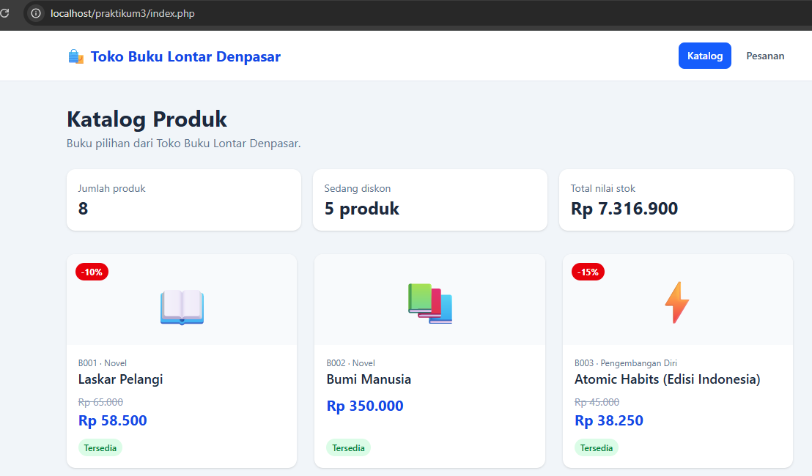
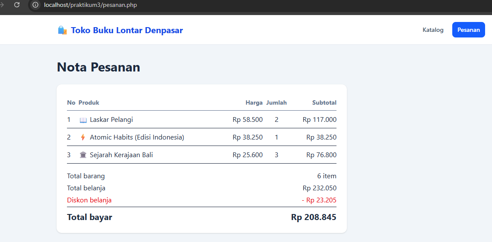

# Praktikum 3 PHP - Toko Buku Lontar Denpasar

## Identitas
- Nama: [Rio Rinaldi Suan]
- NIM: [2501020054]
- Program Studi: Rekayasa Sistem Komputer

## Deskripsi
Toko Buku Lontar Denpasar merupakan website katalog buku
yang dibuat menggunakan PHP dan Tailwind CSS.
Website menampilkan daftar buku, harga, diskon, status
stok, ringkasan nilai stok, serta nota pesanan pelanggan.

## Tantangan
[Yaitu, saya kesulitan memahami logika dan struktur sintaks PHP jika hanya melihat kode kosong (blank page) atau penjelasan teoretis yang abstrak. Oleh karena itu, saya memanfaatkan AI sebagai alat bantu utama dalam proses belajar.

## Screenshot

